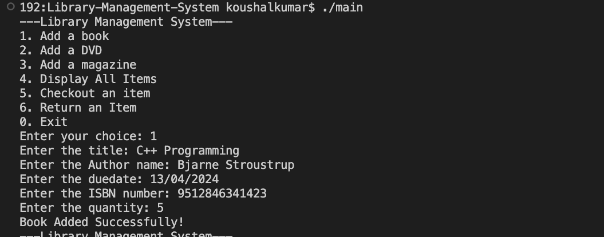

# Library Management System Using C++

## Short Description
A console-based Library Management System developed using C++. This project allows users to add books, DVDs, and magazines, display library items, and perform checkout and return operations.

## About the Project
The Library Management System is a simple C++ project designed to manage different types of library items. It uses object-oriented programming concepts to organize library information and operations.

The program provides a menu-driven interface where users can add books with ISBN and quantity, DVDs with duration, and magazines with issue numbers. Users can also display the details of all stored items and perform checkout and return operations.

## Features
- Add books with title, author, due date, ISBN, and quantity.
- Add DVDs with title, author, due date, and duration.
- Add magazines with title, author, due date, and issue number.
- Display details of all library items.
- Check out library items.
- Return library items.
- Use a menu-driven console interface.
- Display item information using a common base class.

## Technologies Used
* C++
* Visual Studio Code
* G++ Compiler
* Github

## C++ Concepts Used
- **Class and Object:** Defines `LibraryItem`, `Book`, `DVD`, and `Magazine` classes.
- **Abstraction:** Uses `LibraryItem` as an abstract base class with pure virtual functions.
- **Encapsulation:** Keeps data members private and accesses common attributes through getters and setters.
- **Inheritance:** Derives `Book`, `DVD`, and `Magazine` from `LibraryItem`.
- **Polymorphism:** Uses base-class pointers and overridden virtual functions to display and operate on different item types.
- **Constructors:** Initializes library item details when objects are created.
- **Destructor:** Demonstrates the use of a destructor.
- **Virtual Functions:** Defines common operations for checkout, return, and displaying details.
- **Arrays of Pointers:** Stores multiple library items using an array of `LibraryItem` pointers.
- **Conditional Statements:** Handles menu choices and validation.
- **Loops:** Uses a `do-while` loop for the menu and a `for` loop to display items.
- **Strings:** Stores titles, author names, due dates, and ISBN values.
- **User Input and Output:** Uses `cin`, `getline()`, and `cout`.

## Requirements

* Visual Studio Code
* C++ compiler such as G++

# Installation

1. Install **VS Code**.
2. Install the **G++ compiler**.
3. Create a project folder.
4. Create a C++ file named `main.cpp`.
5. Write the program into `main.cpp`.

# How to Run

Open the VS Code terminal and run:

```bash
g++ main.cpp -o main
```

Then run the program:

```bash
./main
```

## Project Structure

```text
├── main.cpp
├── README.md
└── output.png
```

## Screenshots



## Future Improvements
- Search for library items by title.
- Prevent duplicate or invalid library entries.
- Track available and borrowed copies of books.
- Update item status after checkout and return.
- Improve input validation for all item types.
- Introduce a graphical user interface in a future version.

## Author
**Supriya Thakur**

